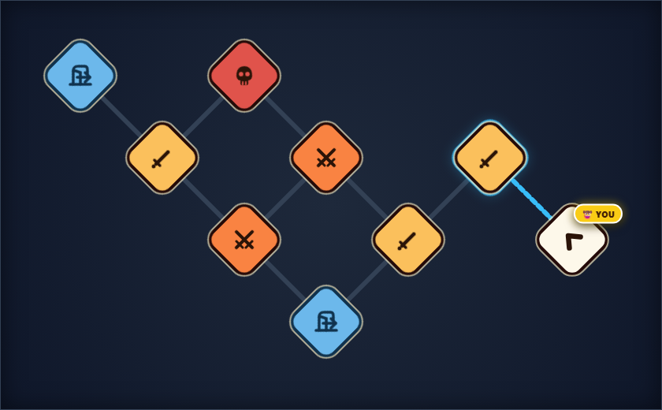

# Class Cards Extraction (Unlocks) · Game Design Document

**Prototype:** `prototypes/class-card-extraction-unlocks` (playable). Where this document and the prototype differ, this document is the design.
**Numbers:** tuned with the balance simulation in `sim/`.

---

## 1. The game in one paragraph

You own a **stash** of animal cards. You take up to 9 of them on an **expedition**: 3 in your **team** and 6 in **camp**. You walk a small **map** of battles. Each battle is an automatic **3-vs-3 card fight**: you choose who fights and in what order, then you watch. Winning gets you new cards. Losing costs you the 3 cards that fought. Reaching an **extraction point** brings everything you carry home. Every run earns **XP**, and every level **unlocks a new card** for the rest of the game.

**Pillars**
1. **Readable fights.** The player can predict a battle by looking at it. Every rule below serves this.
2. **Risk you choose.** Pushing deeper gives more XP and cards, but every battle puts cards at stake.
3. **Always progressing.** Even a bad run fills the XP bar. There is always a next card to discover.

---

## 2. Core loop

```
 Home (stash, collection, XP bar)
   │  choose up to 9 cards (3 team + 6 camp), or take the free starter expedition
   ▼
 Map ──► pick a battle node ──► Prep (see the enemy, set your 3 and their order) ──► Battle (auto)
   ▲                                                                                  │
   │◄──── win: pick reward cards, node cleared ◄──────────────────────────────────────┤
   │◄──── tie: no cards gained, none lost, node not cleared ◄─────────────────────────┤
   │◄──── lose: the 3 fighting cards are lost, node not cleared ◄─────────────────────┤
   │            (fewer than 3 cards left: the run ends, the rest go home)             │
   ▼
 Extraction node ──► all carried cards go to the stash ──► Debrief (XP, unlocks) ──► Home
```

---

## 3. Cards

### 3.1 What a card is

Every card has:
- a **class**, which sets its color and frame: plain, healer, support, warrior, warlock or rotator;
- its own **HP** and **ATK**;
- **at most one ability**: a **trigger** (when it fires) and an **effect** (what it does). Plain cards have no ability.

Names follow the pattern **[class]_[index]**, e.g. `healer_1`.

Buffs and damage last only for the battle they happen in. Every battle starts with the card's printed stats. There is no max HP: "give HP" can raise a card above its printed HP.

### 3.2 Why some cards have no abilities

5 of the 20 cards are **plain**: stats only.
- **Teaching.** The starter pack is plain, so the first runs teach only the clash: slots, order, HP and ATK. Abilities arrive one at a time through unlocks (§8).
- **Extremes of power.** Without ability text, a card's value is just its body. That lets plain cards be both the best card in the game (plain_1) and the worst (plain_3).
- **Calm.** A fight with a plain card or two has fewer things happening, which helps readability.

### 3.3 The card list

Grade = how much the card raises the chance to win, measured in thousands of simulated battles. **S** is best, **D** is worst.

| Card | HP | ATK | Ability | Grade |
|---|---|---|---|---|
| plain_1 | 9 | 3 | none | S |
| plain_2 | 9 | 2 | none | C |
| plain_3 | 5 | 1 | none | D |
| plain_4 | 8 | 1 | none | D |
| plain_5 | 5 | 2 | none | D |
| healer_1 | 7 | 2 | 🏁 Start: give the friend in front 2 HP | C |
| healer_2 | 8 | 1 | 💢 Hurt: give the friend behind 2 HP | A |
| healer_3 | 5 | 2 | 💀 Death: give a random friend 4 HP | C |
| support_1 | 7 | 1 | 🗡️ Attack: give the friend behind 1 ATK | A |
| support_2 | 8 | 1 | 💀 Death: give a random friend 2 ATK | C |
| support_3 | 6 | 1 | 🏁 Start: give all friends 1 ATK | B |
| warrior_1 | 4 | 3 | 🏁 Start: deal 3 damage to the last enemy | C |
| warrior_2 | 5 | 2 | 🗡️ Attack: deal 2 damage to the 2nd enemy | A |
| warrior_3 | 6 | 2 | 💀 Death: deal 2 damage to all enemies | B |
| warlock_1 | 6 | 1 | 🏁 Start: remove 1 ATK from all enemies | B |
| warlock_2 | 8 | 2 | 💀 Death: remove half of the killer's ATK (round down) | C |
| warlock_3 | 7 | 1 | 🗡️ Attack: set the first enemy's ATK to 1 | B |
| rotator_1 | 9 | 2 | 🏁 Start: push the first enemy to last | B |
| rotator_2 | 8 | 2 | 🗡️ Attack: pull the lowest-HP enemy to the front | C |
| rotator_3 | 10 | 2 | 💀 Death: push the highest-ATK friend to the front | B |

**Some cards are meant to be better than others.**
- **Choice has meaning.** Picking a reward or a lineup is a real decision only if the options differ.
- **Progression feels good.** Unlocks should feel like upgrades. Every ability card is far stronger than the three weakest starter cards (plain_3, plain_4, plain_5).
- **Within limits.** Only plain_1, the final unlock, is grade S. Every ability card is A, B or C, so every card is someone's best pick in some lineup.

**Battle length:** HP is high enough that **99% of battles last 6 or more clashes** (12 on average). No card's battles drop below 96%. Fights have an opening, a middle and a finish, and a single hit never decides them.

---

## 4. Combat

### 4.1 Board

- **Each team always has 3 slots.** Slot 1 is the **front**. Both sides always field 3 cards.
- During prep the player sees the enemy lineup in order, picks 3 of their cards and sets the order.

**Why 3 vs 3:** The player has to picture the whole fight in their head before it starts: who meets whom, who gets buffed, who gets hit by "2nd enemy". With 4 vs 4 that is too much to visualize, and the fight stops being predictable. Three slots also give every position a clear role (front / middle / back), and allow only 6 possible orders, which a player can actually compare.

### 4.2 The enemy always goes first

Whenever both sides act at the same moment, **the enemy's abilities resolve first**.

**Why:** You see the enemy before the fight, so a fixed order makes the fight fully plannable. "Their warlock_1 fires before my support_3" is something you can count on. A coin flip would add randomness the player can't play around.

### 4.3 How a battle plays out

1. **Start:** every 🏁 start ability fires once, enemy side first. Within a side, the card with the highest ATK fires first.
2. **Clash:** the two front cards fire their 🗡️ attack abilities (enemy first), then **hit each other at the same time**, each dealing its ATK as damage.
3. **Hurt:** every card that took damage fires its 💢 hurt ability, even if that hit killed it.
4. **Death:** dead cards leave and fire their 💀 death abilities. The cards behind them step forward.
5. Repeat from step 2 until one side has no cards left.

If both sides lose their last card in the same clash, the battle is a **tie**.

### 4.4 Rules that matter

- **Hurt fires on the killing hit too.** The card fires its hurt ability first, then dies. *Why:* the killing blow is the most important hit a card takes. If a hurt card ignored it, it would look like a bug ("it got hit and nothing happened").
- **A card that is already dead can't be hit again**, so it never fires hurt twice from one death.
- **ATK never drops below 1.** *Why:* a card with 0 ATK can never finish a fight. Two of them would stall forever, and warlocks would switch enemies off completely.
- **"Friend in front / behind" means the nearest living friend** in that direction.
- **An ability with no valid target does nothing.** For example, "friend behind" with nobody behind.
- **Death abilities fire after the card has left the team**, so "a random friend" never picks the dying card.

### 4.5 Ties

About 8% of battles end in a tie. **A tie is a tie:** the player gains no cards and loses no cards. They return to the map, and the node is not cleared.

---

## 5. Abilities

### 5.1 Triggers

| Trigger | When | How often |
|---|---|---|
| 🏁 Start | Before the first clash | Once per battle |
| 🗡️ Attack | Just before each clash, only while the card is in the front slot | Every clash it is in front for |
| 💢 Hurt | Each time it takes damage, including the hit that kills it | Every hit |
| 💀 Death | When it dies and leaves the team | Once |

Each class has one card per trigger it uses, so a class's three cards play differently.

### 5.2 Targets

| Target | Meaning |
|---|---|
| friend in front / behind | Nearest living friend in that direction |
| random friend | Any living friend except itself |
| all friends | Every living friend except itself |
| highest-ATK friend | Living friend with the most ATK (tie: the one closest to the front) |
| first / 2nd / last enemy | By current position among living enemies |
| all enemies | Every living enemy |
| lowest-HP enemy | Living enemy with the least HP (tie: the one closest to the front) |
| killer | The card that dealt the killing damage |

### 5.3 Classes

- **Healer:** keeps the team alive by giving HP. healer_1 has to stand **behind** the card it protects, which is the first lesson that position matters.
- **Support:** makes others hit harder by giving ATK. Its cards are weak fighters themselves (1 ATK).
- **Warrior:** fragile cards (4–6 HP) that deal damage outside the clash, so they can hit enemies other than the front card.
- **Warlock:** shrinks enemies by removing their ATK. It is strongest against hard hitters.
- **Rotator:** changes the order of cards. Tough bodies (8–10 HP) whose abilities shine against specific lineups. See §9.

---

## 6. Map



*Blue: extraction points. Yellow: easy battles. Orange: medium. Red skull: hard. White: start.*

**Rules**
- From your current node you can move to any neighbor you haven't visited yet.
- **You can't enter a node from which no extraction point can still be reached.** You can never trap yourself.
- A battle node is cleared only when you **win** it. After a tie or a loss you stay where you were.
- Routes range from 2 battles (easy, easy, nearest exit) to 6 (through the hard node and back).

**Enemies by difficulty** (always 3 cards, drawn from the cards the player has **unlocked**):

| Node | Enemy cards | Reward on win |
|---|---|---|
| Easy | 3 cards graded C or D | pick 1 of 3 offered |
| Medium | 3 random unlocked cards | pick up to 2 of 3 |
| Hard (skull) | 3 cards, at least one graded S or A | pick up to 3 of 4 |

Battle 1 of a run is always easy. The target player win rates are about 80% for easy, 60% for medium and 40% for hard.

---

## 7. The run (expedition)

| Rule | Value |
|---|---|
| Team slots | **3** (both sides, always) |
| Camp size | **6** |
| Max cards carried | 9 |
| Min cards to start | 3 |
| Free starter expedition | Always available: the 4 starter cards, which don't come from the stash |

**Flow**
1. **Loadout:** pick up to 9 cards from the stash. They leave the stash and are now at risk.
2. **Map:** choose a node (§6).
3. **Prep:** see the enemy lineup. Move cards between camp and team, and reorder the team.
4. **Battle:** automatic (§4).
5. **Win:** the node is cleared. Pick reward cards (§6). Rewards are random unlocked cards. If the camp is full, discard a card to take one, or skip.
6. **Tie:** nothing gained, nothing lost. Back to the map.
7. **Lose:** **the 3 cards that fought are lost**. Your camp cards are safe, and you're back on the map. If fewer than 3 cards remain, the run ends and the remaining cards go home.
8. **Extraction node:** the run ends in success. Every carried card goes to the stash, and you get the extraction XP bonus.

**Why camp 6:** it holds two full teams' worth of reserves. That's enough to counter-pick each enemy you see in prep, to recover from a lost battle, and to take reward picks without discarding every time.

**Why a loss costs only the fighting cards:** a single bad battle hurts but doesn't erase the run. The player decides how much to risk each time by choosing which 3 cards fight. Putting their best cards in means a higher chance to win, but a bigger loss if they don't. The extraction door is still the decision point: "cash out now, or push one more node?"

---

## 8. Progression (XP and unlocks)

### 8.1 Why progression

- **A reason to come back.** Every run moves the XP bar, even a bad one. There is always "one more run to the next card".
- **Mystery.** Locked cards appear in the collection as **silhouettes**, showing only their class color, trigger icon and the level that unlocks them. The player knows something is coming but not what it does, and wants to find out.
- **Slow introduction.** 15 abilities on day one would overwhelm a new player. Unlocking them one at a time, in a designed order, teaches each trigger and class on its own.

### 8.2 Why XP

- **XP rewards playing, not only winning**, so a losing run still progresses.
- **One visible bar** is easy to read and builds anticipation ("40 XP to the next card").
- **The designer controls the order and pace** of new cards. A shop would let players skip ahead to the strongest cards.

### 8.3 XP sources

| Source | XP |
|---|---|
| Each card that fights in a battle | **22** (66 per battle, win or lose) |
| Each battle won | **25** |
| Reaching an extraction point | **50** |
| First run ever | **50** (once) |

XP is never lost. **Why these numbers:** about 70% of a battle's XP comes from fighting at all, so losing still pays. Winning adds about 40% on top. Extraction is worth about two wins, so getting out alive is never the XP-poor choice. The first-run bonus makes the first unlock almost certain. A typical run earns about **350 XP**. A short safe run earns 232 and a full 6-battle run 596.

### 8.4 Levels and unlock order

One level = **one new card**. There are 16 levels. The whole collection takes about 25 runs.

| Level | Total XP | ≈ after run | Unlocks | Teaches |
|---|---|---|---|---|
| 1 | 200 | 1 | support_3 | 🏁 Start trigger, Support |
| 2 | 650 | 2 | warrior_1 | Warrior: damage outside the clash |
| 3 | 1,000 | 3 | healer_1 | Healer, **position matters** |
| 4 | 1,350 | 4 | warlock_1 | Warlock: removing ATK |
| 5 | 1,700 | 5 | rotator_1 | Rotator: moving cards |
| 6 | 2,050 | 6 | warrior_3 | 💀 Death trigger |
| 7 | 2,575 | 7–8 | healer_3 | Death + random target |
| 8 | 3,100 | 9 | support_2 | |
| 9 | 3,625 | 10–11 | warlock_2 | Death + "killer" |
| 10 | 4,150 | 12 | rotator_3 | |
| 11 | 4,850 | 14 | support_1 | 🗡️ Attack trigger (only in front) |
| 12 | 5,550 | 16 | warrior_2 | |
| 13 | 6,250 | 18 | rotator_2 | |
| 14 | 6,950 | 20 | warlock_3 | |
| 15 | 7,825 | 22–23 | healer_2 | 💢 Hurt trigger (every hit, even the killing one) |
| 16 | 8,700 | 25 | plain_1 | The strongest card, as the final reward |

**Starter pack (unlocked from the start):** plain_2, plain_3, plain_4, plain_5.

**Why this curve**
- **Level 1 at 200** is reached by almost every first run, even one that ends after two battles. A new card at the end of the first session is the hook.
- **Levels 2–6: about one card per run.** Each class arrives with its simplest card, a 🏁 start ability.
- **Gaps then grow** (350 → 525 → 700 → 875 XP), to about one card every 2–3 runs. By then the player has plenty to play with, and the later cards are the more complex ones.
- **Triggers arrive in order of how hard they are to read:** 🏁 start (once, before the fight) → 💀 death (once) → 🗡️ attack (repeats, only in front) → 💢 hurt (repeats, on every hit).
- **plain_1 comes last:** no text to learn, just the strongest card in the game.

### 8.5 What an unlock does

The card is added to the **unlocked pool**. From then on it can appear as a battle reward and in enemy lineups. The debrief screen reveals it, turning the silhouette into the card.

---

## 9. Open questions

1. **Rotator abilities.** In simulation, moving cards on its own barely changes who wins. Rotators are balanced through their tough bodies (8–10 HP). Pairing each move with a small effect would make the abilities matter, for example rotator_1: "push the first enemy to last and deal 2 damage to it".
2. **Enemy cards per difficulty** (§6) are a first proposal. Check them against the target win rates in playtests.
3. **XP pacing** assumes about 350 XP per run. Check it in playtests, and scale all thresholds together if it is off.
